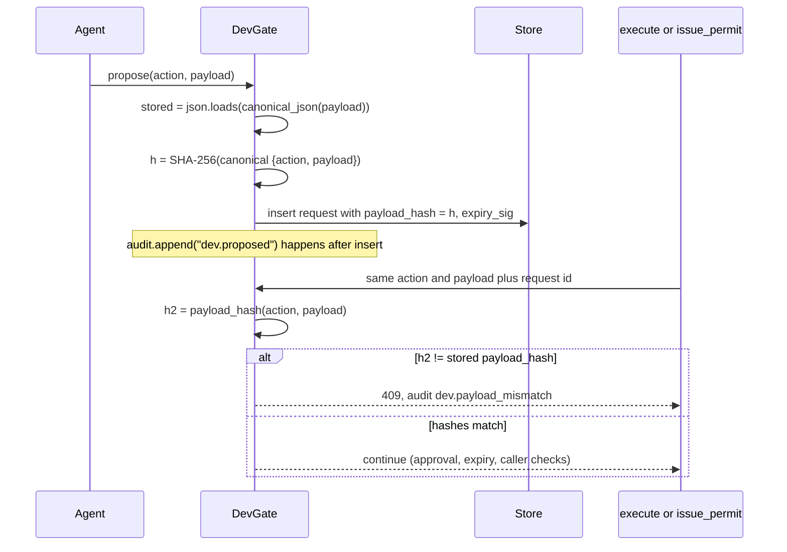
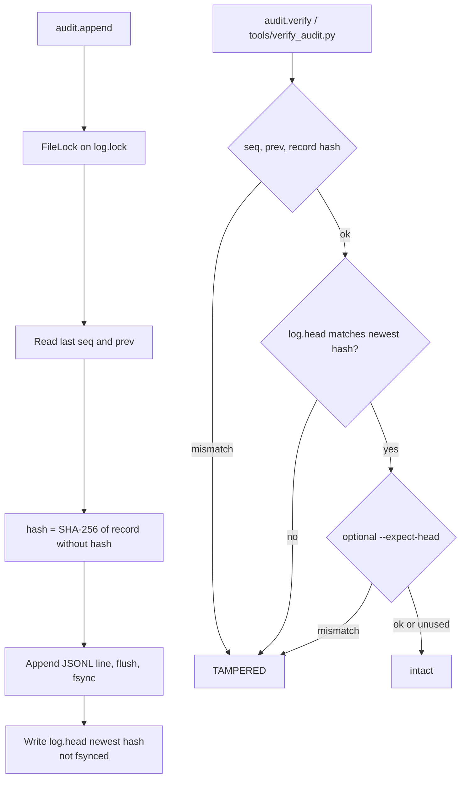
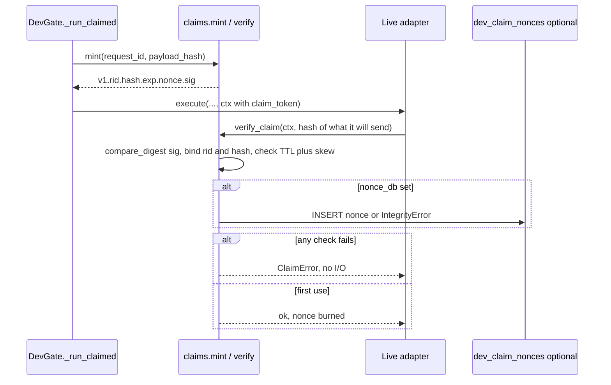
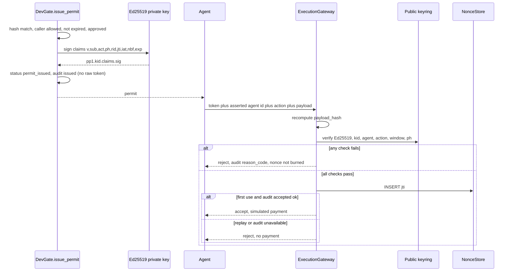

# Sentinel Forge: hashing and key management

**Sentinel Forge** is a documentation label for the hashing and key-management controls already
implemented in this repository. It is not a module, package, API, or product name in the code.

Status: **design notes for what the code does today**, on local branch `docs/sentinel-forge-hashing`
(off `feat/oracle-intel-sec-edgar`, `01dfdc2`). This document describes only mechanisms that exist in
the tree, with file and function references. The audit log is append-only and tamper-evident (hash
chain); edits are detectable, not impossible. Nothing here is a readiness, certification, or
compliance claim.

Companion docs (do not contradict them; this note gathers the crypto and binding pieces in one place):
`docs/dev-governance.md`, `docs/dev-governance-gaps.md`, `docs/execution-gateway-v0.md`,
`docs/structured-outputs-audit-reports.md`.

Worked examples of tamper detection (synthetic keys and data only) are in
`tests/test_sentinel_forge_doc_examples.py`. Broader behavior is covered by the existing suites
named in those companion docs.

---

## 1. Scope

Four mechanisms, plus the audit-report digest that sits on top of the log:

| Mechanism | Where | Primitive |
|---|---|---|
| Content binding (`payload_hash`) | `dev_governance/gate.py`, duplicated in `execution_gateway/permit.py` | SHA-256 over strict canonical JSON of `{action, payload}` |
| Audit chain | `audit.py`; independent check in `tools/verify_audit.py` | SHA-256 hash chain, `.head` file, `FileLock`, `fsync` |
| Execution claim tokens | `dev_governance/claims.py` | HMAC-SHA256, 60 s TTL, single-use nonce |
| Execution-gateway permits | `execution_gateway/{issuer,permit,gateway,nonces}.py` | Ed25519, `kid`, 5-minute default TTL, public keys only on the gateway |

Out of scope here: the SEC EDGAR connector's network controls (no additional hashing or key
management beyond the shared audit log); capability-grant issuance and revocation in
`dev_governance/authority.py` (grants, not signing keys); Oracle Intelligence report hashes in
`oracle_intelligence/`.

---

## 2. Map of the mechanisms

```mermaid
flowchart TB
  subgraph GATE [Dev gate - propose then approve then execute or issue]
    P[DevGate.propose<br/>payload_hash action plus payload] --> S[(Request store<br/>payload_hash plus expiry_sig)]
    S --> A[Human approve]
    A --> E[DevGate.execute]
    A --> I[DevGate.issue_permit]
    E --> C[claims.mint HMAC-SHA256<br/>request_id, payload_hash, exp, nonce]
    I --> K[(Ed25519 private key<br/>0600 file or in-process)]
  end
  C --> L[Live adapter<br/>claims.verify_claim before I/O]
  K --> T[Permit pp1.kid.claims.sig]
  T --> GW[ExecutionGateway.handle<br/>public keys only]
  GW --> N[(NonceStore jti burn)]
  P -. dev.proposed after insert .-> LOG[(Audit JSONL<br/>prev plus hash plus .head)]
  E -. claimed / executed / some refusals .-> LOG
  I -. dev.permit.issued .-> LOG
  GW -. accepted or rejected .-> LOG
  LOG --> V[audit.verify and tools/verify_audit.py]
  V --> R[tools/audit_report.py<br/>report_hash is a digest, not a signature]
```

The four primitives do different jobs. `payload_hash` binds a later execute or permit to the exact
approved content. The audit chain records what happened so later edits of the log are detectable.
Claim tokens make the gate the choke point for *live adapters* that run inside the same process.
Permits make the gate the choke point for the *execution gateway*, which is given verification
material only.

---

## 3. Payload hash (content binding)

Implemented in `dev_governance/gate.py`: `canonical_json` and `payload_hash`. The same functions are
duplicated in `execution_gateway/permit.py` so the gateway does not import the gate. A test in
`tests/test_execution_gateway.py` pins that the two hashes match.

`canonical_json(obj)` walks the value and refuses (HTTP 422 / `malformed_input`) unless every dict
key is a string and every value is JSON (`None`, `str`, `bool`, `int`, `float`, list/tuple, or dict).
It then emits `json.dumps(..., sort_keys=True, separators=(",", ":"), ensure_ascii=False,
allow_nan=False)`, so `NaN` / `Infinity` and non-JSON types never enter the hash. There is no
`default=str`.

`payload_hash(action, payload)` is SHA-256 (hex) of the UTF-8 bytes of

```text
canonical_json({"action": (action or "").strip().lower(), "payload": payload or {}})
```

It is not a signature. Anyone can compute a hash for any payload. Binding comes from *when* the
hash is stored and *what* later checks compare it to.

Where it is used:

- `DevGate.propose` stores `payload_hash(action, stored)` on the request after a strict JSON
  round-trip of the payload (`json.loads(canonical_json(payload))`).
- `DevGate._expiry_sig` / `_expire_if_due` include that hash in the HMAC over the expiry window
  (`claims.sign_fields`, below), so a store edit that changes `payload_hash` (or the window) fails
  closed: the request is marked expired and `dev.expiry.tampered` is audited.
- `DevGate.execute` and `DevGate.issue_permit` recompute the hash from the caller-supplied action
  and payload and refuse with 409 plus `dev.payload_mismatch` if it differs from the stored hash.
- `PermitIssuer.issue` writes the approved hash into signed claim `ph`.
- `ExecutionGateway.handle` recomputes `payload_hash(action, payload)` from the body it received
  and `PermitVerifier.verify` rejects `payload_mismatch` unless it equals `ph`.



**Protects against:** swapping the action or payload after propose without a new approval; a live
adapter or gateway sending a different body than the one whose hash was approved; silent
canonicalization surprises (`default=str`, `NaN`, non-string keys).

**Does not protect against:** an attacker who can rewrite unsigned store fields such as `status` or
the `approvals` list (those are not covered by `expiry_sig`); anyone computing a hash for a *new*
proposal (that is intended); confidentiality of the payload (the hash is a fingerprint, not
encryption).

---

## 4. Audit chain

Implemented in `audit.py`. `tools/verify_audit.py` re-implements the published record format with
the standard library only (no PATIENCE imports) so verification does not trust the writer.

Each line is one JSON object:

```text
{"seq", "ts", "event", "actor", "data", "prev", "hash"}
```

- `hash` = SHA-256 (hex) of `json.dumps(record without "hash", sort_keys=True, separators=(",", ":"), default=str)`.
- `prev` is the previous record's `hash`, or 64 zeros (`GENESIS`) for the first record.
- `seq` is 1, 2, 3, … and must match the line number.

This canonical form is **not** the same as `gate.canonical_json`: it uses `default=str`, does not
set `allow_nan=False` or `ensure_ascii=False`, and does not reject non-JSON values. The difference
is historical. `tools/verify_audit.py` `_digest` matches `audit._digest` on purpose.

`audit.append` (`audit.append`):

1. Takes a `FileLock` on `<log>.lock` (timeout 30 s).
2. Reads the last record with `_last` (last 64 KiB of the file) to get `seq` and `prev`.
3. Builds the record, sets `hash`, appends one JSON line, `flush` + `os.fsync` the log file.
4. Writes the newest hash to `<log>.head` via `Path.write_text` (this write is **not** itself
   `fsync`'d).
5. Releases the lock.

`audit.verify` walks every line and fails on invalid JSON, a sequence gap or reorder, a `prev`
mismatch, a record-hash mismatch, or a `.head` file whose contents do not equal the newest hash.
If the log is missing but a `.head` file exists, that is also a failure. `python audit.py verify`
exits 0 if intact and 1 if not.

`tools/verify_audit.py` adds `--expect-head HEX` (compare the newest hash to a value pinned
somewhere else) and `--require-head`. There is no automatic off-box anchoring; pinning is a manual
operator step.

`tools/audit_report.py` builds a redacted summary and sets `report_hash` to SHA-256 of the
canonical report body *excluding* `report_hash` and `generated_at` (`finalize`). The module
docstring and the report's own `limits` list state that `report_hash` detects accidental
corruption of the report file and **is not a signature**. `verify_report` also re-checks the live
log and regenerates the report; a party who can rewrite the log, its `.head` file, *and* the
report together is not detected unless the head hash was pinned out of their reach.



**Protects against:** editing, deleting, inserting, or reordering a line, or cutting lines off the
end *without* also rewriting `.head`, being detected by `verify`. Concurrent writers are serialized
by the lock; a write that reaches `fsync` is on disk.

**Does not protect against:** an attacker who can rewrite **both** the log and its `.head` file and
recompute a consistent chain (the code and `tools/verify_audit.py` document this limit). The `.head`
value is not automatically published or anchored anywhere else. `report_hash` does not authenticate
the author of a report. A crash after the log `fsync` and before the `.head` write (or before that
write reaches disk) can make a valid log look truncated until the head is repaired.

---

## 5. Claim tokens (HMAC-SHA256)

Implemented in `dev_governance/claims.py`. The gate mints a token only after it has atomically
claimed an approved request for a *live* adapter (`DevGate._run_claimed` sets `ctx["claim_token"]`
when `adapter.live` is true). Adapters marked `live = True` must call `verify_claim(ctx,
action_payload_hash)` immediately before I/O. A missing, expired, reused, forged, or
request/payload-mismatched token raises `ClaimError`.

Wire format (`claims.mint`):

```text
v1.{request_id}.{payload_hash}.{exp}.{nonce}.{sig}
```

- `exp` is `int(clock()) + ttl` (`CLAIM_TTL_SECONDS = 60` by default).
- `nonce` is `secrets.token_hex(12)`.
- `sig` is HMAC-SHA256 (hex) over the ASCII bytes `v1|{request_id}|{payload_hash}|{exp}|{nonce}`
  (`claims._sig`).

`claims.verify` requires six dot-separated parts and version `v1`, checks the HMAC with
`hmac.compare_digest`, binds `request_id` and `payload_hash` the same way, then enforces the
window: expired if `now > exp + skew`; "expiry is too far in the future" if
`exp > now + CLAIM_TTL_SECONDS + skew`. Skew is `PATIENCE_CLAIM_SKEW` (default 5, clamped 0..30;
`MAX_SKEW_SECONDS = 30`).

Single use: the nonce is recorded in an in-process dict (`_used`) under a thread lock, and, when
`nonce_db` is set (the gate passes the SQLite store path; `verify_claim` also honors
`PATIENCE_CLAIM_NONCE_DB`), in table `dev_claim_nonces` via an atomic `INSERT` on a primary key
(`_burn_shared`). A reused nonce is `ClaimError`. A SQLite error fails closed ("claim nonce store
unavailable; refusing"). In-process entries older than one hour are dropped; the shared table is
pruned the same way on each burn. Tokens minted with the per-process secret do not survive a
restart, which the module treats as acceptable given the 60-second TTL.

**Secret source** (`claims._secret`), first match:

1. Environment variable `PATIENCE_CLAIM_SECRET`, if its length is at least 32 characters.
2. Else a file secret `_FILE_SECRET`, if `claims.use_secret_file(path)` has been called. `DevGate`
   calls this with `<store path>.key` when the store is a real file (not `:memory:`). The file is
   created once with `os.O_WRONLY | os.O_CREAT | os.O_EXCL` and mode `0600`, then passed through
   `dev_governance.fsperm.secure_file` (chmod 0600, including SQLite sidecars if present). The
   contents are used only if they are at least 32 characters.
3. Else a random per-process secret (`_PROCESS_SECRET = secrets.token_bytes(32)`).

Anyone who can read the env var or the key file can mint expiries and claim tokens.

**Signed expiry** (`claims.sign_fields` / `check_fields`): HMAC-SHA256 over
`"|".join([kind] + [repr(f) for f in fields])`. `DevGate._expiry_sig` uses kind `expiry-v1` and
fields `(request_id, payload_hash, created_at, expires_at)`. The default approval window is
`approval_ttl_seconds` in `policies/dev/default.yaml` (3600), loaded as `DevPolicy.ttl`. An edited
or missing signature, or a window longer than policy TTL, expires the request (`_expire_if_due`).



**Protects against:** calling a live adapter's `execute` without a fresh gate-minted token; reusing
a token; presenting a token for a different request or payload; forging a token without the secret;
extending a request's approval window in the store without the secret.

**Does not protect against:** anyone who holds the claim secret; replay across workers if no shared
`nonce_db` is configured (in-process `_used` is not visible to other processes); confidentiality of
the token in logs or crash dumps (callers must not log it; the audit-report denylist treats `token`
/ `nonce` as secrets). Claim tokens are not used on the execution-gateway path (permits are).

---

## 6. Ed25519 permits

PATIENCE signs; the gateway verifies with public keys only. There is no HMAC fallback: if the
`cryptography` package is missing, `PermitIssuer` raises `PermitError` and no permits are issued.

### 6.1 Format and signature

`execution_gateway/permit.py`. Wire format:

```text
pp1.<kid>.<claims_b64url>.<signature_b64url>
```

- `VERSION_TAG` is `pp1`.
- `kid` is the first 16 hex characters of `sha256(raw 32-byte Ed25519 public key)` (`key_id`).
- Claims are canonical JSON (`sort_keys=True, separators=(",", ":")`), then base64url without
  padding (`b64e`). Required keys, and only these plus `"v": 1`: `sub` (agent / proposer id),
  `act` (action), `ph` (approved payload hash), `rid` (request id), `jti` (16-byte hex nonce),
  `iat`, `nbf`, `exp` (epoch seconds).
- Signature: Ed25519 over the ASCII bytes `"pp1." + kid + "." + claims_b64url` (`signing_input`).
  The version tag and key id are inside the signed bytes.

`PermitVerifier` holds a keyring of public keys only. A keyring entry whose `kid` does not match
`key_id(public key)` is a configuration error at construction. `verify` does **not** consume the
permit; single use is enforced by `NonceStore` in the gateway. Failures raise `PermitRejected` with
a stable reason code (no soft outcomes). Default TTL is 300 s; issuer clamp `MAX_TTL_SECONDS` is
900 s; default clock skew is 5 s; tokens longer than `MAX_TOKEN_CHARS` (4096) are malformed.

### 6.2 Issuance and key files

`execution_gateway/issuer.py`: `PermitIssuer`, `PermitIssuer.from_file`, `issuer_for_store`.

`PermitIssuer.issue` builds the claims, signs, and returns the wire string plus `jti`, `kid`,
`iat`, `exp`. TTL defaults to 300 s, is clamped to 900 s, and is shortened by `not_after` (the
gate passes the approval's `expires_at`). A window that has already ended raises `PermitError`.

Key location, first match (`issuer_for_store`):

1. `PATIENCE_PERMIT_SIGNING_KEY_FILE`, if set and non-empty.
2. Else `<gate store db path>.permit_key`, when the store is a real file (not `:memory:`).
3. Else an ephemeral in-process key, cached under `_CACHE[("ephemeral",)]` so API requests that
   build a new `DevGate` still share one key.

`from_file` creates the file once with `O_EXCL` and mode `0600`, then `_secure` (`chmod 0600`,
errors ignored), then reads 64 hex characters as a 32-byte Ed25519 seed. A missing `cryptography`
package, or an unreadable or malformed file, raises `PermitError` (fail closed: no permits).
`public_keys()` returns `{kid: public_hex}` and never the private key.

`DevGate.issue_permit` applies the same preconditions as execute (hash match, proposer or owner,
kill switch and breaker, unexpired, fully granted). Issuing is a compare-and-swap that sets status
to terminal `permit_issued`, so a request yields at most one permit. The permit is bound to the
**proposer's** id (`sub`), not the caller's, even if an owner requested it. The audit event
`dev.permit.issued` records `permit_id` (`jti`), `key_id`, hashes and times, not the raw permit
string.

### 6.3 Gateway verification and nonces

`execution_gateway/gateway.py`: `ExecutionGateway.handle`, `keyring_from_env`.
`execution_gateway/nonces.py`: `NonceStore`.

The gateway reads `PATIENCE_DEV_KILL` itself and does not import the gate. Public keys come from
`PATIENCE_GATEWAY_PUBKEYS` (`kid=hexpub,...`) and/or `PATIENCE_GATEWAY_PUBKEYS_FILE` (one
`kid=hexpub` per line). An empty keyring rejects everything as `unknown_key_id`. Documented
decision order (first failure rejects; the raw permit is never logged):

kill switch → permit present → well-formed → known key id → signature → agent → action →
validity window / max lifetime → payload hash → payload shape → single-use nonce burn →
audit `gateway.accepted` → simulated payment → audit `gateway.payment_executed`.

A permit is burned only after earlier checks pass, so a rejected probe does not consume it. If the
accept audit write fails, the request is rejected (`audit_unavailable`) and no payment is made
(the nonce is already burned; a new approval is required). Unexpected exceptions become
`verifier_error`.

`NonceStore` requires a real file path (not `:memory:`). The file is created `0600`; WAL/SHM/journal
sidecars are tightened the same way. `burn` is an atomic `INSERT` on primary key `jti`; a duplicate
returns `False` (`replayed`); any other database error raises `NonceStoreError` and the gateway
rejects. `UPDATE` and `DELETE` are blocked by triggers. Rows are never pruned. The file owner can
still alter the file on disk; the triggers only stop in-SQL updates and deletes.

v0 limitation, documented on `create_gateway_app`: the agent id is asserted by the caller
(`X-Agent-Id`) unless an `agent_id_fn` is supplied. A permit stolen together with that agent id is
accepted until it expires or is used.



**Protects against:** a gateway that holds no private key minting permits; forged or edited
permits (bad signature / unknown kid); presenting a permit for a different agent, action, or
payload; replaying a `jti` against a healthy shared nonce file; using a permit after `exp` (plus
skew) or with a lifetime above the gateway's max; paying when the accept audit cannot be written.

**Does not protect against:** anyone who can read the signing key file or process memory; an empty
or attacker-controlled gateway keyring (wrong keys, or no keys); a stolen unused permit presented
with the asserted agent id; an operator or attacker who rewrites the nonce-store file itself;
key compromise without a rotation/revocation procedure (none is implemented).

---

## 7. Threat model (summary)

| Threat | Control | Detected or refused? | Residual |
|---|---|---|---|
| Payload swapped after approval | `payload_hash` recomputed at execute, issue_permit, and the gateway | Yes, 409 / `payload_mismatch` | Store edits to unsigned fields (`status`, `approvals`) are not hash-bound |
| Approval window extended in the DB | `expiry_sig` via `claims.sign_fields` | Yes, request expires, `dev.expiry.tampered` | Requires keeping the claim secret out of the attacker's reach |
| Live adapter called without the gate | `claims.verify_claim` on `live = True` adapters | Yes, `ClaimError` | Adapters that are not marked live are not covered; claim path is not the gateway path |
| Forged or reused claim token | HMAC + compare_digest + nonce burn | Yes | Secret holders can mint; reuse across processes needs `nonce_db` |
| Forged or edited permit | Ed25519 over `pp1.kid.claims`, kid keyring | Yes, `bad_signature` / `unknown_key_id` | Signing-key holders can mint; no revocation list for a stolen key or `jti` other than expiry + burn |
| Permit replay | `NonceStore.burn` atomic INSERT | Yes, `replayed` | Not if the nonce file is replaced or bypassed on disk |
| Audit line edited, deleted, inserted, reordered | Chain `prev` + record `hash` + seq | Yes, `audit.verify` / `verify_audit.py` | Rewriting the log *and* `.head` together forges a consistent chain |
| Audit tail truncated | `.head` (and optional `--expect-head`) | Yes, if `.head` or a pin still has the old hash | No automatic external anchor; `.head` write is not fsynced |
| Report file corrupted | `report_hash` | Accidental edits of the report, yes | Not a signature; consistent rewrite of log + head + report is undetected without a pin |
| Audit unavailable on a refused execute or approve *attempt* | `DevGate._audit_required` / `DevGate._refuse` | Attempt refused 503 (fail closed) | Covers denied/unapproved execute attempts and the 409/501 execute and approve refusals; not `issue_permit`, `deny`, or ordinary `audit.append` refusals; see gaps |
| Missing `cryptography` or bad permit key file | `PermitError`, no HMAC fallback | Yes, no permit issued | Operator must fix the key or dependency |

---

## 8. Known gaps (checked against this tree)

Each item was confirmed in the code cited. If a companion doc said something broader, the narrower
code fact wins.

1. **No key rotation or revocation for these secrets.** There is no implemented procedure to
   roll the claim HMAC secret, rotate the Ed25519 signing key, publish a new `kid` alongside an old
   one, or revoke a compromised `kid` or unused `jti` other than waiting for expiry and relying on
   burn. Removing a `kid` from the gateway keyring makes existing permits fail as `unknown_key_id`
   (`tests/test_execution_gateway.py` covers that operator move). That is a manual keyring edit,
   not a rotation protocol. (Capability-grant revoke in `authority.py` is a different control and
   does not retire signing keys.)

2. **Audit reports are hashed, not signed.** `tools/audit_report.py` `finalize` sets `report_hash`
   to a SHA-256 digest. The file itself says this is not a signature and does not authenticate who
   wrote the report.

3. **The head hash is not anchored externally by the program.** `audit.append` writes `.head` next
   to the log. `tools/verify_audit.py --expect-head` can compare against a pin an operator supplies;
   nothing here publishes or stores that pin off-box.

4. **`dev.proposed` is audited after the store insert.** In `DevGate.propose`, `self.store.insert(req)`
   runs, then `audit.append("dev.proposed", ...)`. The append is ordinary `audit.append`, not
   `_audit_required`. If the process dies after insert and before the audit write, or if the audit
   write raises, a stored request can exist without a matching `dev.proposed` record, and a failed
   audit does not roll the insert back.

5. **Execute and approve refusals: closed on `feat/audit-refused-attempts`.** `_audit_required`
   covers `dev.execute.denied_attempt` (403) and `dev.execute.unapproved_attempt` (202). The new
   helper `DevGate._refuse` now writes, fail closed, one `dev.execute.refused` event (with a
   `reason` code, `http_status`, request id and payload hash) for every execute refusal that used
   to leave no record: `already_used` (status `executed` / `executing`), `not_executable`,
   `permit_only` (permit-gated action sent to execute), `no_adapter` (501), `contention` (CAS gave
   up, 409), and `expired` / `already_expired` (expired on this call vs. before it; `dev.expired` is
   still written once for the transition). Approve-path 409s write `dev.approve.refused` with
   `expired`, `already_expired`, `not_pending` or `duplicate_approver` (and `contention`). If the
   audit write fails the caller gets 503 and the request is unchanged. Status codes and messages of
   the refusals are unchanged. Tested in `tests/test_audit_refused_attempts.py`.
   Still not audited on the refusal itself: the `issue_permit` 409s (already used, not approved,
   expired), `deny` on a non-pending request (409), and the plain 404 for an unknown request id.
   Refusals that already used ordinary `audit.append` (for example `dev.payload_mismatch`,
   `dev.execute.forbidden`) still write best effort, not fail closed.

6. **`.head` is not fsynced.** The log line is `flush` + `os.fsync`; `_head(p).write_text(...)` is
   not. A crash in that window can make `verify` report truncation of an otherwise intact log.

7. **Unsigned store fields.** `expiry_sig` covers `request_id`, `payload_hash`, `created_at`, and
   `expires_at` only. Status, approval lists, owners, and results are not signed. Detecting a
   silent store edit of those fields would require an out-of-band comparison with the audit log;
   the gate does not do that comparison automatically.

8. **Gateway agent id is asserted in v0.** `create_gateway_app` documents this. Binding the permit
   to `sub` does not, by itself, authenticate the presenter.

---

## 9. Safe extension ideas

These are ideas only. None of them is scheduled work, and listing them does not mean they should
be implemented without a separate, approved change.

- Pin the audit head hash somewhere the log writer cannot reach, and check it with
  `--expect-head` (or an equivalent) on a schedule. The hook already exists; automatic transport
  does not.
- Add a real signature over audit reports (or a detached signature of `report_hash`) so a report
  can be authenticated without trusting whoever can rewrite the file.
- Design a key-rotation path: a new permit `kid` published to the gateway keyring before the old
  key is removed; a planned rollover of `PATIENCE_CLAIM_SECRET` / the claim key file; a revocation
  list or kill step for a compromised `kid`. Until then, treat key compromise as "minting power
  for the current secret."
- Extend the fail-closed refusal audit (`DevGate._refuse`) to the `issue_permit` and `deny`
  409s, and move the older best-effort refusal events onto it.
- Write `dev.proposed` (fail closed) before or atomically with the store insert, or roll back the
  insert if the audit write fails.
- `fsync` the `.head` file after writing it, still under the same lock.
- Optionally align `audit._digest` with the stricter `canonical_json` used for payload hashes,
  behind a versioned record format so existing logs still verify.

Any extension should keep using test keys only in development, never commit or print real key
material (`.key`, `.permit_key`, `PATIENCE_CLAIM_SECRET`, `.env`, or store/db files), and should
not weaken fail-closed paths.

---

## 10. Wording and limits

Use **append-only** and **tamper-evident** for the audit log. Do not call it immutable. Do not
call this design, the gate, or the gateway production-ready, compliant, or certified. Simulated
payments in the execution gateway are simulated. Claim and permit secrets in tests must be
generated for the test, never copied from a live file.
